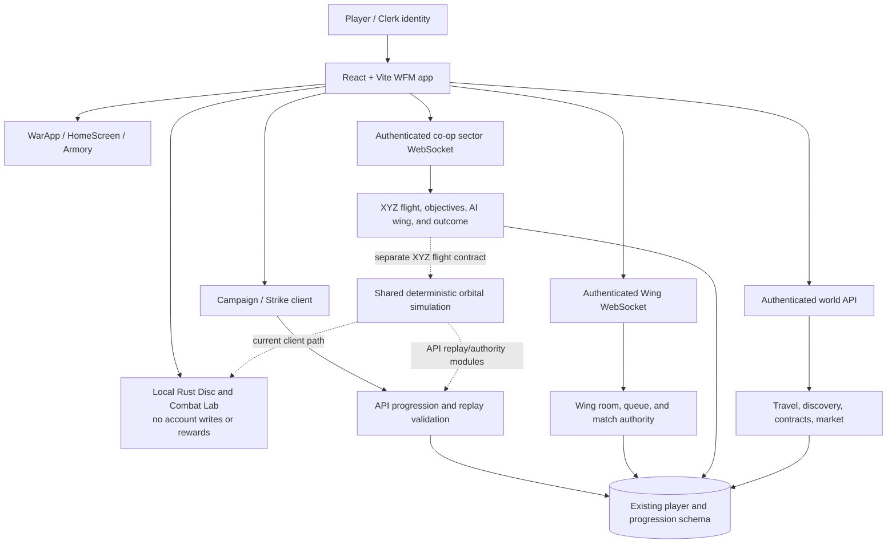

# Infinite War architecture assessment

## Current verified shape

The repository already shares one account identity, database schema, and
progression ledger across multiple features. It does **not** yet share one
combat or mission protocol across every feature. The main architectural risk is
therefore not a lack of modules; it is advancing one simulation or UI while
silently bypassing the existing authority and persistence contracts.

The last dashed relationship marks an integration target, not a current
dependency: sector flight has its own `flight-sector.ts` state/input contract
and uses shared deterministic math primitives, but it is not yet the same
orbital combat protocol. The Wing socket room runtime also remains distinct;
the shared orbital package must not be described as an already integrated
ten-human 3D Wing simulation.

## Owner-directed full-game target

The controlling end state is now the full-game Orbital Engine Consolidation
Directive in
[`ORBITAL-ENGINE-CONSOLIDATION-DIRECTIVE.md`](./ORBITAL-ENGINE-CONSOLIDATION-DIRECTIVE.md),
with the complete owner source preserved in `attached_assets/`. Every mode
ultimately becomes a mission configuration of one canonical orbital simulation.
The diagram above records current code boundaries only; it is not approval to
keep separate mode-specific combat runtimes as the final architecture.

## Target architecture

Keep the current React/Vite and Three.js presentation, but make gameplay
contracts explicit and mode-versioned:

1. **Presentation layer:** one player journey, hangar, operations, world
   navigation, HUD, mobile input, rendering, effects, and audio. UI predicts and
   displays state; it does not authorize results.
2. **Canonical simulation contract:** bounded deterministic movement, targeting,
   weapons, damage, actors, environment, and objectives, with explicit rules and
   protocol versions. Client prediction and server authority consume compatible
   inputs/state; rendering libraries stay outside the simulation package.
3. **Existing authoritative services:** Clerk identity; Wing queue/session
   ownership; co-op sector runtime; campaign replay/claim validation; world and
   economy transactions; progression ledger. Integrate by adapters and staged
   protocol migration, not parallel auth, rooms, player tables, or reward stores.
4. **Validated operation result:** each mode emits a server-owned result with
   player/room scope, rules version, objectives, outcome, and idempotency key.
   Only explicitly eligible operations may call the existing settlement path.
5. **Universe state:** connected locations, travel, discoveries, and future
   strategic conflict state are server-derived. Do not persist territory or
   faction consequences until ownership, conflict resolution, and replay
   semantics are defined.

## Integration sequence and gates

1. **Inventory and contracts:** preserve the code-backed inventory and matrix.
   For every mode, record its runtime, authoritative inputs/snapshots/results,
   persistence calls, feature flags and rollback path.
2. **Canonical simulation identity and parity:** share a versioned engine
   identity across browser, API, socket and replay. Pin deterministic traces
   before moving mode behavior.
3. **Offline migration:** move local Rust Disc, Arcade and training to the
   canonical runtime while keeping them no-reward.
4. **Campaign migration:** migrate every sortie through server-issued runtime
   versions and mission-specific objective adapters; preserve legacy replay for
   already-issued runs.
5. **Co-op migration:** adapt sector operations and Iron Eclipse while retaining
   authenticated room ownership, reconnection, server AI/objectives and
   idempotent discovery settlement.
6. **Competitive migration:** coordinate a new client/API/socket capability on
   staging. Require ten distinct authenticated humans, balanced teams,
   consistent authority, reconnect/interruption handling and existing reward
   ledger tests before reward-eligible orbital Wing is enabled.
7. **Unified navigation and bounded expansion:** connect all migrated
   operations to the Hangar/Universe journey. Add persistent consequences and
   anomalies only as server-owned, deterministic, bounded mechanics.

## Non-negotiable boundary

The Combat Lab and local Rust Disc trainer stay offline/no-reward. A signed-in
profile, successful build, healthy deployment, local simulation, or two-pilot
private match is not proof of ten-player competitive 3D authority, reward
settlement, or Production readiness. Do not merge or deploy a partial
client/API/socket protocol.
