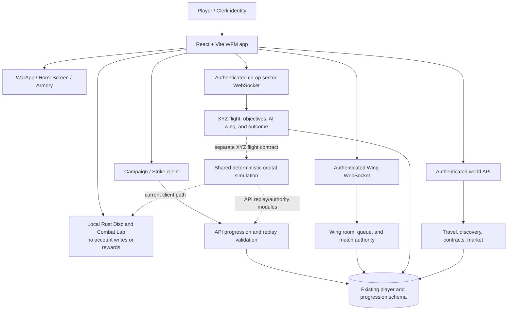

# Infinite War architecture assessment

## Current verified shape

The repository already shares one account identity, database schema, and
progression ledger across multiple features. It does **not** yet share one
combat or mission protocol across every feature. The main architectural risk is
therefore not a lack of modules; it is advancing one simulation or UI while
silently bypassing the existing authority and persistence contracts.

The last dashed relationship marks an integration target, not a current
dependency: sector flight has its own `flight-sector.ts` state/input contract
and uses shared deterministic math primitives, but it is not yet the same
orbital combat protocol. The Wing socket room runtime also remains distinct;
the shared orbital package must not be described as an already integrated
ten-human 3D Wing simulation.

## Target architecture

Keep the current React/Vite and Three.js presentation, but make gameplay
contracts explicit and mode-versioned:

1. **Presentation layer:** one player journey, hangar, operations, world
   navigation, HUD, mobile input, rendering, effects, and audio. UI predicts and
   displays state; it does not authorize results.
2. **Canonical simulation contract:** bounded deterministic movement, targeting,
   weapons, damage, actors, environment, and objectives, with explicit rules and
   protocol versions. Client prediction and server authority consume compatible
   inputs/state; rendering libraries stay outside the simulation package.
3. **Existing authoritative services:** Clerk identity; Wing queue/session
   ownership; co-op sector runtime; campaign replay/claim validation; world and
   economy transactions; progression ledger. Integrate by adapters and staged
   protocol migration, not parallel auth, rooms, player tables, or reward stores.
4. **Validated operation result:** each mode emits a server-owned result with
   player/room scope, rules version, objectives, outcome, and idempotency key.
   Only explicitly eligible operations may call the existing settlement path.
5. **Universe state:** connected locations, travel, discoveries, and future
   strategic conflict state are server-derived. Do not persist territory or
   faction consequences until ownership, conflict resolution, and replay
   semantics are defined.

## Integration sequence and gates

1. **Inventory and contracts:** preserve the code-backed inventory and matrix
   linked from this document. For each mode, name the authoritative input,
   snapshot/result, persistence call, feature flag, and rollback path.
2. **One mission adapter:** adapt an existing co-op operation first. Prove its
   briefing → loadout → shared 3D runtime → objective → debrief → existing
   idempotent discovery settlement, with no new player or reward schema.
3. **Combat kernel parity:** replace duplicate spatial math only when browser,
   server, replay, and existing sector behavior match under pinned deterministic
   traces. Keep reward-eligible planar Wing behavior unchanged until its own
   migration is ready.
4. **Competitive protocol:** introduce a new explicit version/capability. Run
   client, API, and socket together on staging. Require ten distinct
   authenticated humans, balanced teams, consistent authoritative state,
   reconnect/interruption handling, and existing reward eligibility/ledger
   tests before enabling it.
5. **Unified navigation:** expose campaign, co-op, competitive, exploration,
   and training as operations in one hangar/world journey. Preserve existing
   direct paths and account state until replacement acceptance is met.
6. **Persistent consequences and anomalies:** add only as server-owned,
   deterministic, bounded mechanics after the relevant multiplayer,
   persistence, and performance gates pass.

## Non-negotiable boundary

The Combat Lab and local Rust Disc trainer stay offline/no-reward. A signed-in
profile, successful build, healthy deployment, local simulation, or two-pilot
private match is not proof of ten-player competitive 3D authority, reward
settlement, or Production readiness. Do not merge or deploy a partial
client/API/socket protocol.
